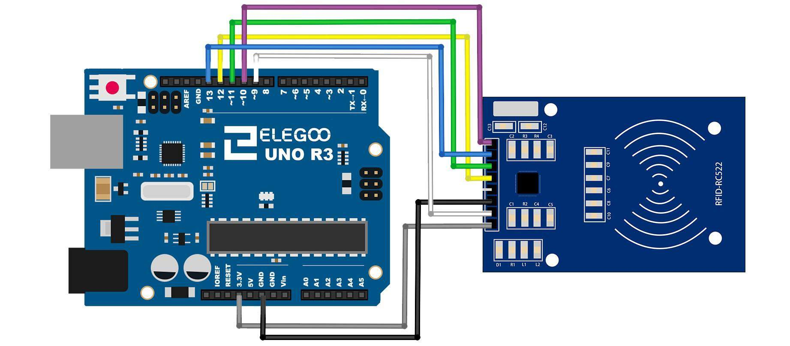
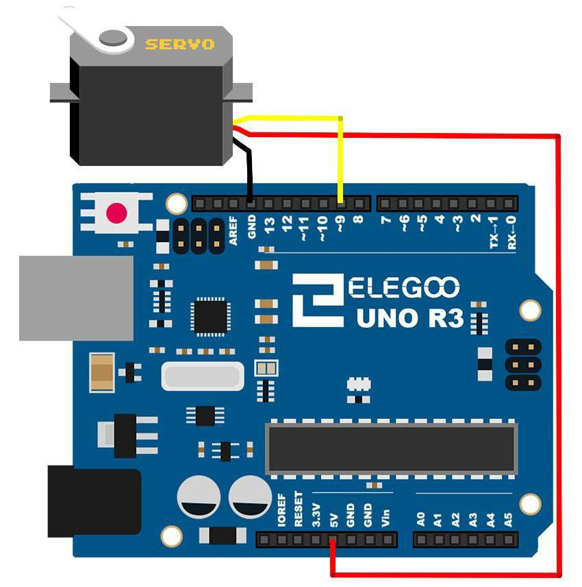

# The Finale — The Job

## Mission brief

This is the job everything was for. The crew has a room — call it a
vault, a safehouse door, a workshop you don't want wandering hands
in — and you are building the thing that guards it. Not a toy
version: a device that watches the room, knows who you are, knows
what time it is, tells you what it's doing on a screen, and moves a
bolt when the answer is yes.

Every module in this course is in here somewhere. If a piece of it
confuses you, the module it came from is listed beside it, and going
back to that module is not failure — it's how a real build works.

## What you're building

A vault door system with four states:

- **ARMED** — the door is locked, the LCD shows the time, and the
  system is watching.
- **ALARM** — motion was detected *and* something is close to the
  door, so the buzzer sounds and the LCD says so.
- **GRANTED** — the right card was presented inside the allowed
  hours, so the servo turns the bolt and the door opens for five
  seconds.
- **DENIED** — the wrong card, or the right card at the wrong hour,
  so the buzzer buzzes low, the LCD says denied, and the bolt stays
  shut.

Every event is logged to the Serial Monitor with a timestamp, the
way Module 7's time lock did — because a guard that doesn't write
things down is just a decoration.

## What you need

Elegoo UNO R3, breadboard, HC-SR501 PIR sensor, HC-SR04 ultrasonic
sensor, RC522 RFID reader with a card, DS1307/DS3231 RTC module,
1602 LCD, SG90 servo, passive buzzer, separate battery pack for the
servo, jumper wires including female-to-male.

## The wiring: one pin map, no conflicts

This is the part of a combined build that trips people up: each
module on its own used whatever pins were convenient, and those
choices collide when you put them together. So this build uses one
deliberate pin map, and it differs from the individual modules in
places. Follow *this* map, not the ones from Modules 5–8:

| Part | Connection |
| --- | --- |
| PIR motion sensor | Output → pin 2, power 5V/GND |
| HC-SR04 ultrasonic | Trig → pin 3, Echo → pin 4, power 5V/GND |
| Servo (bolt) | Signal → pin 5, power from the separate pack, grounds tied |
| LCD | RS → pin 6, EN → pin 7, D4 → A0, D5 → A1, D6 → A2, D7 → A3, contrast pot on VO |
| Buzzer | Pin 8 |
| RC522 RFID | SS → pin 10, RST → pin 9, MOSI → pin 11, MISO → pin 12, SCK → pin 13, VCC → **3.3V**, GND → GND |
| RTC | SDA → A4, SCL → A5, VCC → 5V, GND → GND |

Why the LCD moved: Module 6's LCD used pins 7–12, which the RFID
reader's SPI bus now needs. The LCD's data pins work just as well
on A0–A3 used as digital outputs, so the LCD moved there and SPI
kept its pins. Why the ultrasonic moved: its Module 5 pins (12 and
11) are SPI pins too. Checking for collisions like this, before you
wire anything, is a real engineering skill, and it's the first
thing to do on any combined build.


*The RFID wiring, as in Module 7 — the SPI pins are the ones this
build protects. Diagram: Elegoo tutorial, Lesson 21.*


*The servo wiring, as in Module 8 — note this build moves the
signal to pin 5, since pin 9 is the RFID reader's reset line.
Diagram: Elegoo tutorial, Lesson 9.*

## The code: a state machine

The sketch is in
[this module's folder](finale-the-job/vault-door/vault-door.ino).
Its structure is the important part, more than any single line:

```
loop:
  show the time on the LCD (ARMED, unless another state is active)
  if a card is presented:
    check UID and hour, as in Module 7
    granted -> servo to 90 degrees, LCD "GRANTED", wait 5 seconds,
               servo back to 0, LCD "ARMED"
    denied  -> low buzz, LCD "DENIED", log it
  if PIR is HIGH and ultrasonic distance < 50 cm:
    alarm -> buzzer on, LCD "ALARM", log it with the time
    alarm clears when motion stops
```

A state machine is just a variable that says what mode you're in,
plus rules for when it changes. Every interesting device you've
ever used works this way, and writing one by hand — rather than a
tangle of `if` statements with no structure — is the difference
between a sketch that works and a sketch you can still understand
next week.

Libraries needed, all from the Library Manager: RTClib (RTC),
MFRC522 (RFID), LiquidCrystal (built into the IDE), Servo (built
into the IDE). Set the RTC once with the `adjust` line, then
comment it out, as Module 7 warned. Replace the placeholder UID
with your own card's UID, printed by Module 7's reader sketch.

## Testing it, in order

Test in this order, because each step isolates one failure:

1. **LCD and clock only.** Comment out the sensor checks and
   confirm the LCD shows the time. If it doesn't, it's the
   contrast pot or the LCD wiring — fix it before anything else.
2. **Card only.** Present your card and confirm GRANTED, then a
   wrong card and confirm DENIED. If both deny, the UID is wrong;
   if both grant, the comparison is wrong.
3. **Motion only.** Wave at the PIR with nothing near the door
   and confirm *no* alarm — then put your hand near the ultrasonic
   sensor while moving, and confirm the alarm sounds. That pair
   proves the two-sensor rule from Module 5 is working.
4. **The whole job.** Arm it, walk up, present the card, watch
   the bolt turn, walk away, and read the Serial Monitor log.
   That's the course, working, in one device.

## Break it on purpose

1. **Set the allowed hours to a window you're outside.** Present
   the right card and get denied — then read the log and see the
   hour it used. Time-based denial is the most confusing failure
   in this build until you've seen it once.
2. **Unplug the RTC battery.** The clock resets, the log
   timestamps go wrong, and the time window starts denying good
   cards. A dead coin cell looks like a software bug, and now you
   know its signature.
3. **Swap the servo's locked and open angles.** The door "opens"
   when it should lock. Direction errors in physical systems are
   visible in a way software errors aren't — use that.

## If it doesn't work

- Everything dead? Power first — the servo's separate pack, the
  RFID's 3.3V, the UNO's USB — in that order.
- LCD shows blocks? Contrast pot. It is always the contrast pot.
- Card reads nothing? SPI pins, then 3.3V — same checklist as
  Module 7.
- Alarm never sounds? PIR needs a minute to settle after power-on,
  and the ultrasonic sensor needs a hard surface within 50 cm.
- Servo jitters? It's at a mechanical limit, or its power supply
  is sagging — the separate pack, not the UNO's 5V pin, is the
  fix for the second one.

## Extensions: where you go from here

This is a finished course, not a finished device. If you want to
keep going, these are the natural next builds, each one a module's
worth of work on its own:

- **Add the DHT11** (Module 5) and log temperature and humidity
  with each event — a vault that also watches its own climate.
- **Add the relay** (Module 8) so a granted card switches a lamp
  or a fan, not just a servo.
- **Add the dot matrix** (Module 6) as a status board: a tick for
  armed, a cross for alarm, visible across the room.
- **Add a second card** with different hours — a day card and a
  night card — and a log that tells them apart.
- **Replace the buzzer with the keypad** (Module 3) and add a PIN
  as a second factor: card *and* code, either one alone denied.

## Debrief

You started with a blinking light and ended with a device that
watches a room, knows the time, recognises a key, reports on a
screen, keeps a log, and moves a bolt. That's not a toy — it's a
small, honest version of the systems that guard real doors, built
from a kit on a breadboard, by you.

The handler's final report: *the recruit is ready. The crew's door
is yours now.*

*Diagrams in this finale are from the Elegoo Complete Starter Kit
tutorial (Lessons 9 and 21), reused from Modules 7 and 8.*
