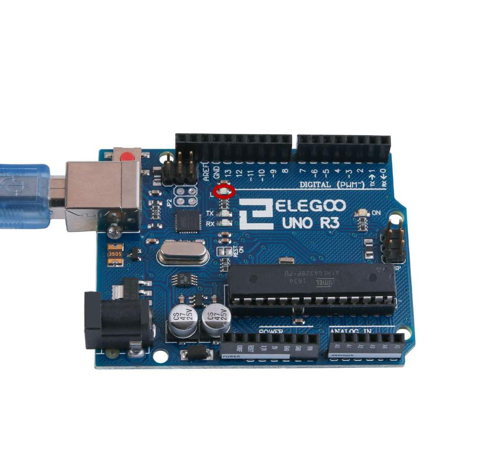
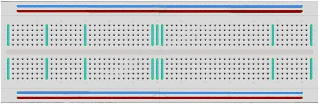
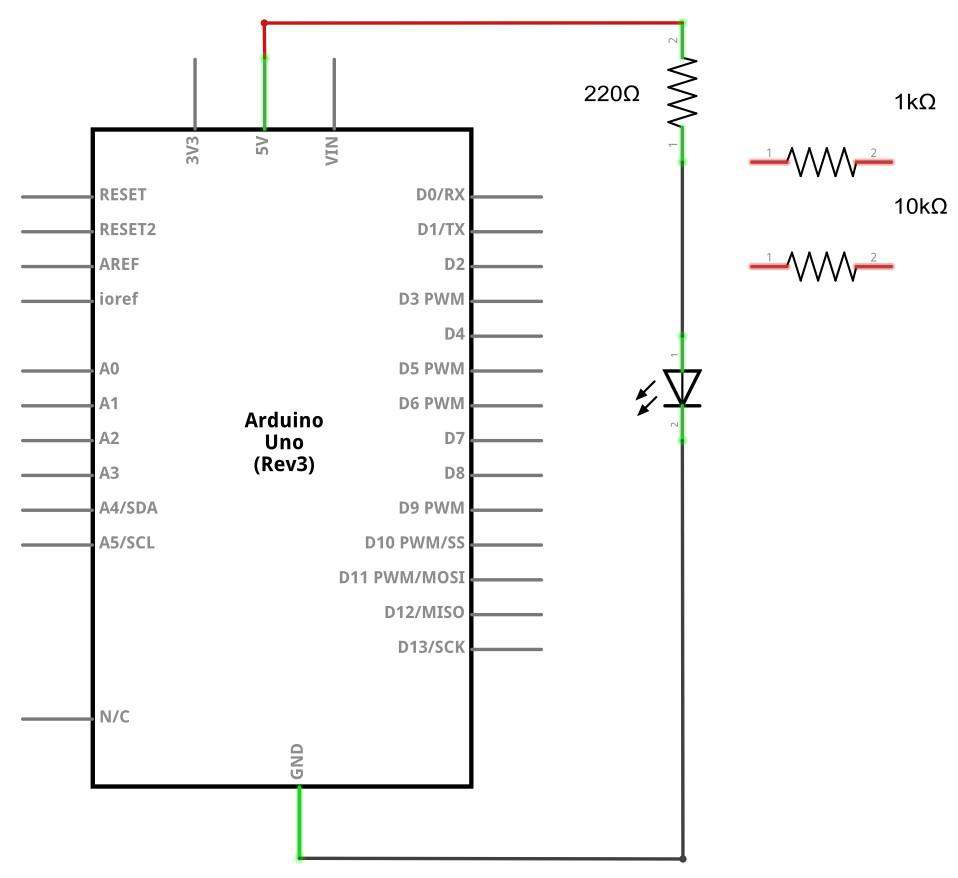
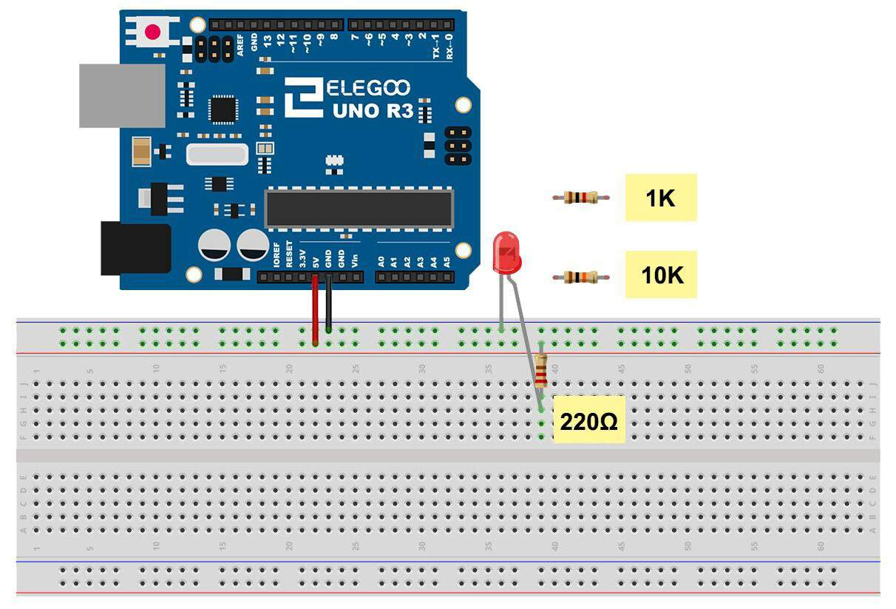

# Module 1 — First Contact

## Mission brief

You got the call. A handler you only know as Dex has left you a package:
a small blue board, a tangle of wires, and a note that says *make it
blink*. No instructions beyond that. If you can get this board to talk
back to you — one light, on your command — you're in. If you can't, the
crew moves on without you.

That board is your Elegoo UNO R3. The light is already on it. Let's go.

## What you'll learn

- How to get code from your Mac onto the board
- What `setup()` and `loop()` actually do
- What a digital pin does when you set it HIGH or LOW
- How a breadboard connects things, and how to wire your first external LED

## What you need

Elegoo UNO R3, USB cable, breadboard, one 5mm red LED, one 220Ω resistor,
two male-to-male jumper wires.

## Part 1 — The board talks first

Install the Arduino IDE from [arduino.cc](https://www.arduino.cc/), plug
the UNO in with USB, and in the IDE select Board: Arduino UNO, then the
port that appears for it (on a Mac it'll look like
`/dev/cu.usbmodem...`). Then open File → Examples → 01.Basics → Blink,
and hit Upload.


*The Elegoo UNO R3. The onboard LED, circled in red, is the one Blink
controls. Diagram: Elegoo tutorial, Lesson 2.*

The board's little LED, labelled L, should start blinking once a second.
If it was already blinking when you plugged it in, that's normal — these
boards ship with Blink pre-installed. You just replaced it with your own
copy, which is the point.

Here's the whole sketch, stripped of its comments:

```cpp
void setup() {
  pinMode(LED_BUILTIN, OUTPUT);
}

void loop() {
  digitalWrite(LED_BUILTIN, HIGH);
  delay(1000);
  digitalWrite(LED_BUILTIN, LOW);
  delay(1000);
}
```

What this is actually saying, in hardware terms:

- `setup()` runs once, when the board powers up or resets.
  `pinMode(LED_BUILTIN, OUTPUT)` tells the board: "I'm going to drive
  this pin, not listen to it." `LED_BUILTIN` is just a name for pin 13,
  which is wired to the onboard LED.
- `loop()` runs forever, top to bottom, then starts again. There's no
  `main()` and no exit — this is the whole program, and it never stops
  unless you unplug the board.
- `digitalWrite(pin, HIGH)` puts 5 volts on that pin. `LOW` puts 0 volts
  on it. That's it. A digital pin has exactly two states, and an LED is
  just something that lights up when there's voltage across it.
- `delay(1000)` pauses for 1000 milliseconds. Change it, re-upload, and
  the blink rate changes. Try 100 sometime — it stops looking like a
  blink and starts looking like a flicker, which tells you something
  about how fast your eyes are.

One thing worth internalising early: once you hit Upload, the code lives
*on the board*. Unplug the USB, plug it into a phone charger, and it
keeps blinking. Your computer was just the delivery truck.

## Part 2 — Your first real circuit

The onboard LED is training wheels. Now build one yourself.

First, the breadboard, because the kit's PDF explains this badly. A
breadboard is a grid of holes with metal strips hidden inside. Holes in
the same short row are connected to each other; holes in different rows
are not. The channel down the middle is a break — nothing crosses it.
The long strips along the edges, usually marked red and blue, are power
rails: every hole in one rail is connected along its whole length.
That's the whole secret. If a circuit isn't working, nine times out of
ten something is in the wrong row.


*How a breadboard connects: the highlighted strips are holes wired
together inside the board. Diagram: Elegoo tutorial, Lesson 3.*

Now the LED. It has two legs, and it cares which way round it goes:

- The longer leg is the anode (positive).
- The shorter leg, next to the flat edge on the plastic case, is the
  cathode (negative).

Wire it like this:

- UNO pin 8 → one leg of the 220Ω resistor
- Other leg of the resistor → a breadboard row, and the LED's long leg
  into that same row
- LED's short leg → a row wired to UNO GND

That's a series circuit: pin → resistor → LED → ground. The order of
the resistor and LED doesn't matter, as long as both are in the path —
current has to flow through both either way. The resistor is there to
choke the current (Module 2 explains exactly how much, and why);
without it, the LED would burn out almost immediately.


*The circuit as a schematic: power, through the resistor, through the
LED, to ground. In Elegoo's original diagram the power comes from the
5V pin, so the LED is always on; in our version it comes from pin 8,
so your code controls it. Diagram: Elegoo tutorial, Lesson 3.*


*The same circuit as a wiring diagram, as Elegoo draws it: 5V (red
wire) and GND (black wire) to the breadboard, the LED and the 220Ω
resistor in series. For our version, move the red wire from the 5V pin
to digital pin 8 — everything else stays exactly as drawn. The 1kΩ
and 10kΩ resistors shown are the ones you'll swap in for the
"break it on purpose" experiment below. Diagram: Elegoo tutorial,
Lesson 3.*

And the code is just Blink with a different pin. The full sketch is in
[this module's folder](module-01-first-contact/blink/blink.ino):

```cpp
const int LED_PIN = 8;

void setup() {
  pinMode(LED_PIN, OUTPUT);
}

void loop() {
  digitalWrite(LED_PIN, HIGH);
  delay(1000);
  digitalWrite(LED_PIN, LOW);
  delay(1000);
}
```

Upload it, and your LED blinks. You just built a circuit and a program
that controls it. Everything else in this course is a variation on that
sentence.

## Break it on purpose

These are safe. Do them, and watch what changes:

1. **Change the delays.** Make it blink fast (100ms), then make an SOS
   pattern: three short, three long, three short. This is the cheapest
   way to learn that `loop()` is just a sequence.
2. **Swap the resistor.** Replace the 220Ω with a 1kΩ, then a 10kΩ (both
   in your kit). The LED gets dimmer each time, and at 10kΩ it's barely
   visible. Same voltage, less current, less light — that's the
   resistor doing its job, and it's the entire preview of Module 2.
3. **Put the LED in backwards.** It won't light. Flip it back and it
   works again — no harm done in this circuit, and now you know what a
   dead LED looks like versus a broken one.
4. **Do not try this one:** wiring the LED with no resistor at all.
   That's not an experiment, that's a funeral. The LED will draw too
   much current and burn out, and it can stress the pin too. The
   resistor is not optional, ever.

## If it doesn't work

- LED dark, code uploaded fine? It's almost certainly backwards, or one
  leg is in the wrong row. Check both before anything else.
- Upload error? Wrong board or wrong port selected, or the USB cable
  isn't seated. The IDE's error messages are famously unhelpful; check
  those two settings first.
- LED flickering or intermittent? A jumper isn't fully pushed in.
  Breadboards are push-fit, and a half-seated wire is the classic
  phantom fault.

## Debrief

You made contact. You can now get code onto a board, drive a pin HIGH
and LOW, read a breadboard, and wire an LED with a current-limiting
resistor. In the story, that's your handler's first report back: *the
new recruit can make a light blink on command*. In reality, it's the
foundation for everything — every sensor, display, and motor in this
course is just a more interesting thing attached to a pin you control
exactly like this one.

Next mission: Module 2, Learn the Grid — where we put real numbers on
voltage, current, and resistance, and you learn why that 220Ω resistor
is 220Ω and not something else.

*Diagrams in this module are from the Elegoo Complete Starter Kit
tutorial (Lessons 2 and 3), cropped from the PDF that ships with the
kit.*
