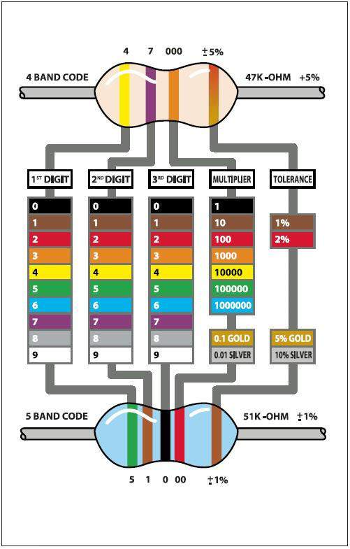

# Module 2 — Learn the Grid

## Mission brief

First mission went clean: you made a light blink on command. Now your
handler wants to know you won't blow your own gear up doing it. Every
operative who's fried a board has the same story — they knew the code
was right, they just didn't know what the *circuit* was doing. This
mission is the grid itself: voltage, current, and resistance. Learn to
put numbers on them, and you'll never wire blind again.

## What you'll learn

- What voltage, current, and resistance actually mean, in numbers
- Ohm's law, and how to use it to pick a resistor instead of guessing
- Why Module 1's LED was bright with one resistor and barely visible
  with another
- Series vs. parallel: what changes, what stays the same, and the one
  parallel mistake that kills LEDs

## What you need

Same kit as Module 1, plus the 1kΩ and 10kΩ resistors and a second red
LED. A multimeter is useful for the optional stretch at the end, but
not required.

## Part 1 — The three quantities

Think of a circuit like water in pipes, just long enough for the
analogy to help and then we'll drop it:

- **Voltage (V, volts)** is the push — how hard the supply is shoving
  charge around. Your UNO's pins push at 5V when HIGH, 0V when LOW.
- **Current (I, amps)** is the flow — how much charge is actually
  moving per second. We usually talk milliamps: 1 amp = 1000 mA. An LED
  happily runs on around 10–20 mA.
- **Resistance (R, ohms, Ω)** is the narrowing in the pipe — how much
  something resists that flow. A resistor's whole job is to be a known,
  controlled narrowing.

They're tied together by the one equation this whole module hangs on,
**Ohm's law**:

**V = I × R**

Rearrange it however you need it: I = V ÷ R, R = V ÷ I. If you know two
of the three, you know the third. That's not a slogan, it's the tool
you'll use in every module after this one.

One more, for later: **power, P = V × I**, measured in watts. It's how
you know if something is getting hot. A resistor dropping 3V at 14mA is
dissipating about 0.04W — nothing. The same resistor dropping 12V at 1A
would be 12W, and it would smoke. You won't meet that in this kit, but
the habit of checking is worth building now.

## Part 2 — Do the maths on Module 1's circuit

Here's the thing the Elegoo PDF never tells you: an LED isn't just a
light, it's a component with a voltage drop of its own. A red LED like
yours drops about **2V** across itself when it's lit (green is a touch
more, blue and white more again — around 3V — which is why the same
resistor gives different brightness for different colours).

So in Module 1's circuit, with the pin at 5V:

- The LED takes 2V, leaving **5V − 2V = 3V** across the resistor.
- The resistor is what sets the current: I = V ÷ R = 3V ÷ R.

Run that for the three resistors in your kit:

- **220Ω:** 3 ÷ 220 = 0.0136A = **13.6 mA** — bright, and comfortably
  safe.
- **1kΩ:** 3 ÷ 1000 = **3 mA** — noticeably dimmer.
- **10kΩ:** 3 ÷ 10000 = **0.3 mA** — barely visible.

That's exactly what you saw when you swapped resistors in Module 1's
"break it on purpose" — it wasn't magic, it was this table. And it
tells you why 220Ω is the kit's default: a typical small LED is rated
for about 20 mA, and an Arduino pin is happiest below 20 mA too (40 mA
is its absolute maximum, and you should never plan to be near it).
13.6 mA sits nicely under both limits.

Now you can also see why no resistor is a disaster: with nothing to
limit it, the current is limited only by the LED and pin's internal
resistance — far more than 20 mA, far more than the LED can survive.
That's the funeral from Module 1, now with numbers attached.

*Reading a resistor's stripes: for a 4-band resistor, the first two
bands are digits, the third is the multiplier, and the last is
tolerance. So red-red-brown-gold is 2, 2, ×10 = 220Ω; brown-black-red
is 1, 0, ×100 = 1kΩ; brown-black-orange is 1, 0, ×1000 = 10kΩ. The
chart also shows the 5-band version, which adds a third digit.
Diagram: Elegoo tutorial, Lesson 3.*

## Part 3 — Build: two LEDs in series

Take Module 1's circuit and add a second red LED in the same chain:
pin 8 → 220Ω resistor → LED 1 → LED 2 → GND. Same code, same blink
sketch — only the hardware changed. The full sketch is in
[this module's folder](module-02-learn-the-grid/blink/blink.ino).

Predict first, then look. The voltages now add up: each LED drops 2V,
so together they take 4V, leaving only **5V − 4V = 1V** across the
resistor. Current = 1 ÷ 220 = **4.5 mA**. Both LEDs share that same
current — series means one path, one current, everywhere — so both
glow, but dimly, and equally.

Two series rules worth memorising:

- Voltages add up around the chain.
- Current is the same everywhere in the chain — and if one LED fails
  open, both go dark, because the path is broken.

## Part 4 — Build: two LEDs in parallel

Now wire them the other way: two separate branches off pin 8, each with
its own resistor and LED, both returning to GND. Use 1kΩ resistors this
time — I'll explain why in a second.

Each branch is its own little Module 1 circuit: 3V across its resistor,
3 mA through its LED. The branches don't interact, so each LED gets its
full 3 mA and they glow equally. But the pin now has to supply the
*sum*: 3 + 3 = 6 mA total. That's why I said 1kΩ, not 220Ω — two 220Ω
branches would ask the pin for 27 mA, over its comfortable 20 mA.
Parallel rule: currents add up at the pin.

And the parallel mistake to never make: **one shared resistor for two
parallel LEDs.** It looks tidier, but LEDs aren't identical — one will
always have a slightly lower forward voltage, hog most of the current,
glow brighter, and run hotter, while the other sulks dim. The hogging
one can then burn out, at which point the survivor suddenly gets *all*
the current and follows it. One LED, one resistor. Always.

*The Module 1 circuit as a schematic — the series chain in Part 3 is
this same circuit with a second LED added in line. Diagram: Elegoo
tutorial, Lesson 3.*

*The same circuit as a wiring diagram. For the pin-controlled version,
the red wire moves from the 5V pin to digital pin 8, as in Module 1.
Diagram: Elegoo tutorial, Lesson 3.*

## Break it on purpose

1. **Predict, then swap.** Before you change a resistor in the series
   circuit, calculate the new current first (remember: 1V across the
   resistor in series, not 3V). Then swap it in and check your
   prediction against the brightness. The goal is to get to where the
   number tells you what you'll see before you see it.
2. **Three LEDs in series.** Add a third red LED to the chain.
   3 × 2V = 6V of drop — more than the 5V supply. What happens?
   (Nothing dramatic: there isn't enough voltage to push them all into
   conduction, so they stay dark or glow faintly. That's a useful
   failure to have seen on purpose.)
3. **Mix colours.** If you have a green or blue LED handy, swap it for
   one red in the series pair and watch the brightness change.
   Different forward voltage, different current, same resistor — the
   maths explains the difference.

## Stretch — if you have a multimeter

Set it to DC volts and measure across the resistor while the LED is on.
You should read about 3V in the single-LED circuit, about 1V in the
series circuit. That's Ohm's law, measured rather than calculated.
Measuring *current* means breaking the circuit and putting the meter
in series — doable, but save it for a day when you're feeling careful;
voltage measurements are the everyday ones.

## If it doesn't work

- Series pair dark? Check the second LED's orientation — one backwards
  LED blocks the whole chain, same as a broken path.
- Parallel pair uneven? One resistor is the wrong value, or one branch
  has a loose wire. Swap the LEDs between branches: if the dimness
  follows the LED, it's the LED; if it stays with the branch, it's the
  branch.
- Everything dimmer than the maths says? Your "5V" from USB is often
  more like 4.7–4.9V in practice. The maths still works — just use the
  real number.

## Debrief

You can now look at a circuit and put numbers on it before you build
it: what voltage is dropped where, what current will flow, and whether
a pin is being asked for more than it should give. Your handler's
report this time: *the recruit doesn't guess resistor values anymore*.
That's the difference between following a wiring diagram and
understanding one — and it's what every later module assumes you can
do.

Next mission: Module 3, The Door Panel — buttons, pull-up resistors,
and why an input pin left to itself reads garbage.

*Diagrams in this module are from the Elegoo Complete Starter Kit
tutorial (Lesson 3), cropped from the PDF that ships with the kit.*
