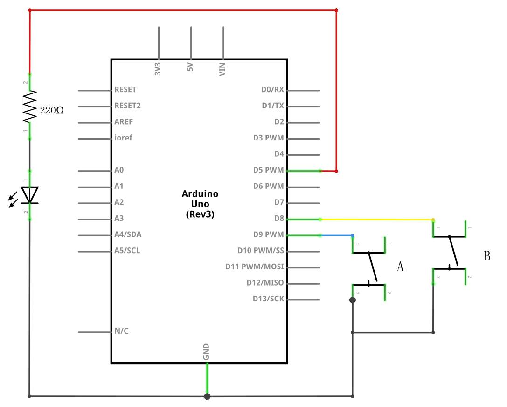
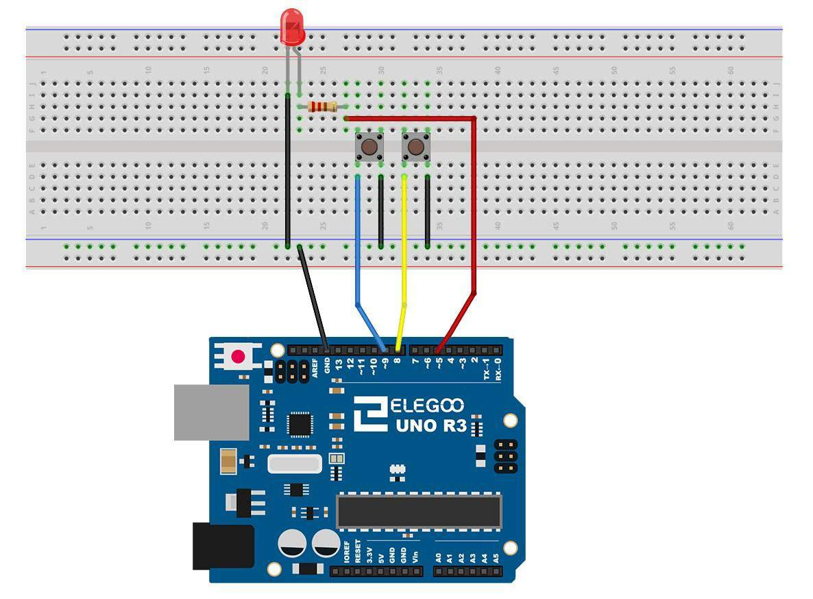
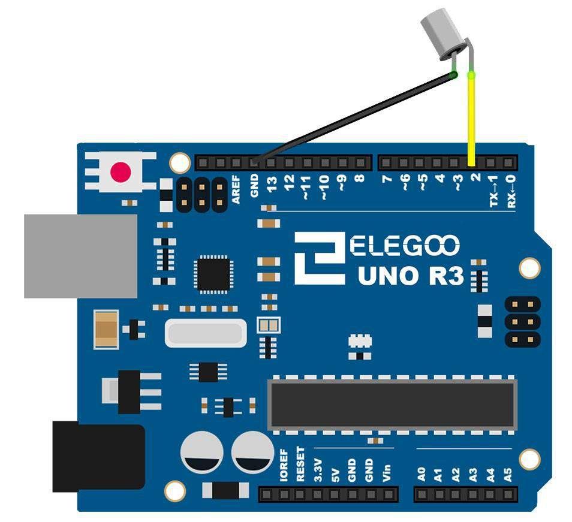
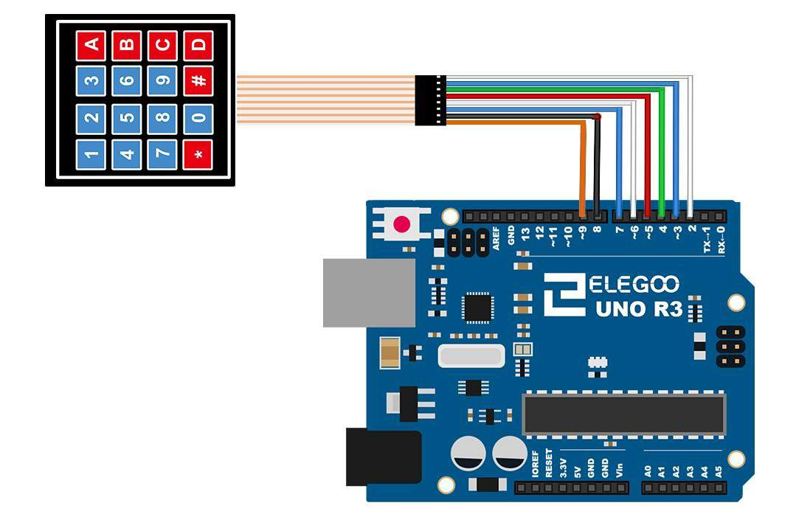

# Module 3 — The Door Panel

## Mission brief

Your handler has a new job, and this time it's not about making a light
blink — it's about getting through a door. Every access panel in the
world is, at heart, the same thing you built in Module 1, run in
reverse: instead of the board telling the world what to do, the world
tells the board. A button pressed, a switch tilted, a code punched in.
This mission is inputs — and inputs, it turns out, are circuits too.
Get them wrong and the board hears things nobody said.

## What you'll learn

- How `digitalRead()` works, and what a floating pin really does
- Pull-up and pull-down resistors, and why the UNO's built-in pull-ups
  are the easy answer
- Why button logic is upside down with a pull-up, and how to live with it
- Debouncing: why one press can look like twenty, and how to fix it in
  software
- Two more real inputs: a tilt switch and a matrix keypad

## What you need

Elegoo UNO R3, breadboard, one 5mm red LED, one 220Ω resistor, two
tactile push buttons, the tilt ball switch, the membrane keypad, jumper
wires (male-to-male, plus female-to-male for the tilt switch).

## Part 1 — The concept: a pin with nothing attached hears voices

In Modules 1 and 2, a pin was an output: you set it HIGH (5V) or LOW
(0V) and it stayed there. An input pin is the opposite job — it
*listens* to whatever voltage is on it, and `digitalRead()` reports
HIGH if that's above about 3V, LOW if it's below about 1.5V.

Here's the trap: a pin connected to *nothing* doesn't read a clean
anything. It's floating, and a floating pin acts like a tiny antenna,
picking up stray electrical noise from the room, your hand, the USB
cable. Read it in a loop and you'll get a stream of random HIGHs and
LOWs. This is the single most common "my button doesn't work" bug in
beginner Arduino, and it's a circuit problem, not a code problem.

The fix is to make sure the pin always has a defined voltage, even when
nobody is pressing anything. That's what a pull-up or pull-down
resistor does:

- **Pull-up:** a resistor from the pin to 5V. Unpressed, the pin sits
  at HIGH. Pressing a button that connects the pin to GND drags it LOW.
- **Pull-down:** a resistor from the pin to GND. Unpressed, the pin
  sits at LOW. Pressing a button that connects it to 5V drags it HIGH.

Either works, but pull-up wins in practice because the UNO has
pull-up resistors *built in* — about 20–50kΩ, inside the chip, free.
`pinMode(pin, INPUT_PULLUP)` switches one on, no extra part needed.
The price is inverted logic: with a pull-up, pressed means LOW and
released means HIGH. It feels backwards for about a day, then it feels
normal. Every build in this module uses INPUT_PULLUP.

## Part 2 — Build: two buttons, one LED

This is Elegoo's Lesson 5, and it's the cleanest possible input
circuit. One button turns the LED on, the other turns it off.

Wiring, from the schematic:

- LED: pin 5 → 220Ω resistor → LED anode (long leg), LED cathode →
  GND. Same as Module 1, just on pin 5 now.
- Button A: one side → pin 9, other side → GND.
- Button B: one side → pin 8, other side → GND.


*The button circuit as a schematic. Note both buttons go to GND — the
pull-ups do the rest. Diagram: Elegoo tutorial, Lesson 5.*


*The same circuit on the breadboard. The tactile buttons have four
pins but only two electrical connections inside — opposite pins are
already joined, so place each button straddling the breadboard's
centre channel, as drawn. Diagram: Elegoo tutorial, Lesson 5.*

That four-pin detail matters: inside a tactile switch, pins A and D are
connected, and B and C are connected. If you place a button with both
legs of one side in the same row, you've shorted it permanently "on"
and pressing it does nothing. Straddling the channel, as in the
diagram, is the safe orientation.

The code is in
[this module's folder](module-03-the-door-panel/buttons-led/buttons-led.ino):

```cpp
const int ledPin = 5;
const int buttonApin = 9;
const int buttonBpin = 8;

void setup() {
  pinMode(ledPin, OUTPUT);
  pinMode(buttonApin, INPUT_PULLUP);
  pinMode(buttonBpin, INPUT_PULLUP);
}

void loop() {
  if (digitalRead(buttonApin) == LOW) {
    digitalWrite(ledPin, HIGH);
  }
  if (digitalRead(buttonBpin) == LOW) {
    digitalWrite(ledPin, LOW);
  }
}
```

Press A, the LED comes on and stays on. Press B, it goes off. Note the
inverted logic in plain sight: `== LOW` means "pressed". If you wrote
`== HIGH`, you'd be testing for "released", and the LED would behave
exactly backwards — the classic first attempt at this circuit.

## Part 3 — Build: one button that toggles, properly debounced

Holding a button to keep a light on is fine for a doorbell. A door
panel wants a toggle: press once, light on; press again, light off.
That needs two new ideas.

First, **edge detection**: don't act on the button *being* pressed,
act on it *becoming* pressed — the moment it changes from HIGH to
LOW. Otherwise `loop()` runs thousands of times a second and toggles
the LED thousands of times while your finger is down.

Second, **debouncing**. A mechanical button doesn't make one clean
contact when you press it. The metal contacts bounce against each
other for a few milliseconds, making and breaking contact several
times. To the Arduino, that's several presses. The fix is to ignore
further changes for about 50ms after the first one — long enough for
the bouncing to settle, short enough that a human never notices.

The code is in
[this module's folder](module-03-the-door-panel/toggle-debounced/toggle-debounced.ino).
The shape of it, stripped down:

```cpp
const int ledPin = 5;
const int buttonPin = 9;
int ledState = LOW;
int buttonState = HIGH;      // released, with INPUT_PULLUP
int lastButtonState = HIGH;
unsigned long lastDebounceTime = 0;

void setup() {
  pinMode(ledPin, OUTPUT);
  pinMode(buttonPin, INPUT_PULLUP);
}

void loop() {
  int reading = digitalRead(buttonPin);
  if (reading != lastButtonState) {
    lastDebounceTime = millis();   // something changed; start the clock
  }
  if ((millis() - lastDebounceTime) > 50) {
    // the reading has been stable for 50ms: believe it
    if (reading != buttonState) {
      buttonState = reading;
      if (buttonState == LOW) {    // a real press, not a release
        ledState = !ledState;
        digitalWrite(ledPin, ledState);
      }
    }
  }
  lastButtonState = reading;
}
```

Why `millis()` and not `delay()`? Because `delay()` freezes the whole
board — nothing else can happen, no other button can be read, no
sensor can be checked. `millis()` just asks "how long since the board
started", so the board stays responsive while it waits. That habit
matters a lot by Module 5, when several things need attention at once.

## Part 4 — Build: a tilt switch

A tilt ball switch is just a button that gravity presses for you: a
little can with a ball inside and two contacts at one end. Tilt it so
that end points down, the ball rolls onto the contacts and shorts
them. Tilt it back, the ball rolls away and the switch opens. No
precision, no calibration — it's on or off, like a button, and you read
it exactly like one.

Wire it with female-to-male jumpers: one side → pin 2, other side →
GND, and use INPUT_PULLUP again. The code is in
[this module's folder](module-03-the-door-panel/tilt/tilt.ino) — read
pin 2, light the LED on pin 5 while the switch is closed (LOW). Tip
the can one way, the light comes on; tip it back, it goes off.


*The tilt switch, wired as a button: pin 2 to one side, GND to the
other, INPUT_PULLUP doing the rest. Diagram: Elegoo tutorial,
Lesson 8.*

In the story, this is a tamper sensor: stick it to a case, and if
anyone picks the case up and tilts it, the board knows. In reality,
it's your first sensor that isn't a button — and it still took exactly
the same code as a button, which is the point. Most digital sensors
are, electrically, just switches with opinions.

## Part 5 — Build: a matrix keypad

Sixteen keys, eight wires. That's the trick of a matrix keypad, and
it's worth understanding because it's how real door panels work.

Inside the keypad, the keys sit at the crossings of 4 rows and 4
columns. Pressing a key connects its row to its column. The Keypad
library scans by driving one row LOW at a time and checking which
column reads LOW — that intersection is the key pressed. 4 + 4 wires
for 16 keys, instead of 16 wires plus ground. The cost is the library
doing the scanning for you, which is a fair trade.

Wiring, from Elegoo's Lesson 11: keypad pins 1–8 → UNO pins 9, 8, 7, 6,
5, 4, 3, 2, in that order. Install the **Keypad** library first
(Sketch → Include Library → Manage Libraries, search "Keypad"). The
code is in
[this module's folder](module-03-the-door-panel/keypad/keypad.ino) —
it prints each key you press to the Serial Monitor (Tools → Serial
Monitor, 9600 baud).


*The keypad's eight pins to UNO pins 9 down to 2. Diagram: Elegoo
tutorial, Lesson 11.*

One honest caveat: keypads vary in how their printed keys map to rows
and columns. If the Serial Monitor shows the wrong character for a
key, the wiring is probably fine and the keymap in the code needs its
rows or columns transposed to match your keypad's layout. Swap the map,
not the wires, first.

## Break it on purpose

1. **Leave a pin floating.** Temporarily change a button pin to plain
   `INPUT` (no pull-up) and disconnect its button. Watch the Serial
   Monitor print garbage as you wave your hand near the board. Then
   put INPUT_PULLUP back and watch it go quiet. That's the floating
   pin lesson, felt rather than told.
2. **Remove the debounce.** Set the debounce delay to 0 in the toggle
   sketch and press the button once. Count how many times the LED
   toggles. Then put 50ms back.
3. **Short a button's own pins.** Place a button with both legs of one
   side in the same breadboard row, so it's permanently "pressed".
   The LED will behave as if someone is holding the button down —
   which is exactly what a shorted switch looks like in the wild.

## If it doesn't work

- Button does nothing at all? Check the button's orientation on the
  breadboard first (straddling the channel), then check you're testing
  for LOW, not HIGH.
- LED toggles randomly without touching anything? A floating pin —
  you forgot INPUT_PULLUP, or a wire to GND has come loose.
- Keypad prints nothing? Wrong baud rate in the Serial Monitor is the
  usual suspect (9600), followed by the Keypad library not being
  installed at all.
- Keypad prints wrong keys? Keymap mismatch, as above — transpose the
  map before rewiring anything.

## Debrief

Inputs are circuits, not just code. You now know why a pin needs a
defined voltage, how a pull-up gives it one for free, why pressed
means LOW, and how to turn a bouncing mechanical contact into one
clean event. Your handler's report: *the recruit can build a door
panel — and, more importantly, can tell when a panel is lying to it*.

Next mission: Module 4, Eyes and Ears — analog inputs, PWM, and the
world that isn't just HIGH and LOW.

*Diagrams in this module are from the Elegoo Complete Starter Kit
tutorial (Lessons 5, 8, and 11), cropped from the PDF that ships with
the kit.*
