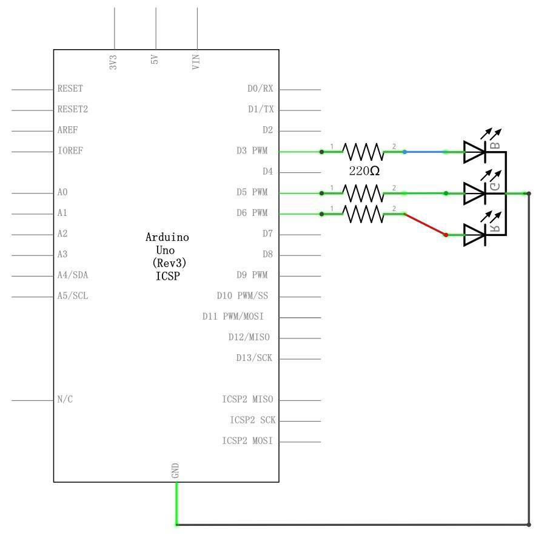
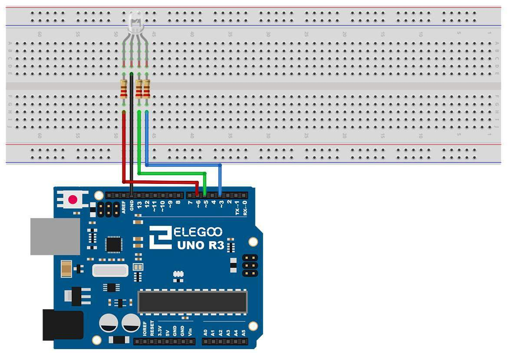
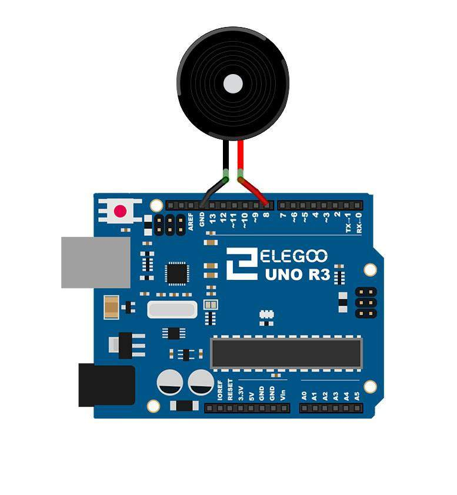
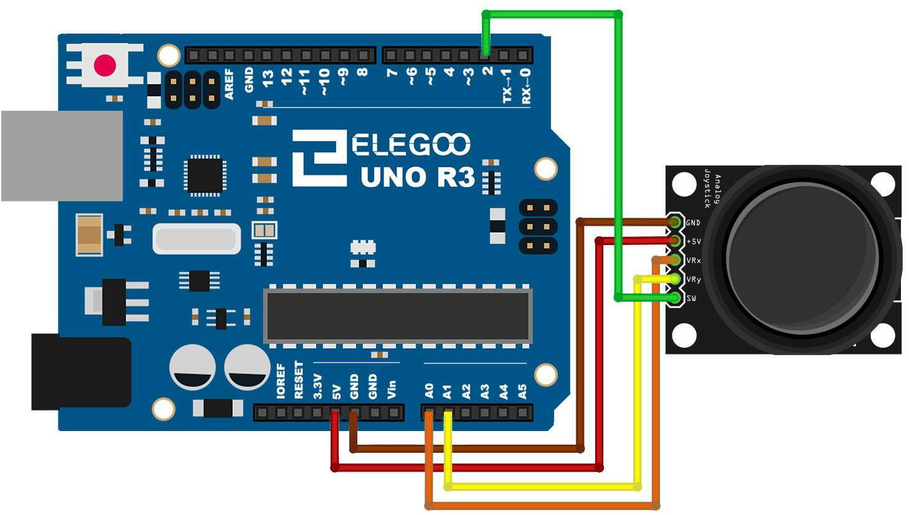

# Module 4 — Eyes and Ears

## Mission brief

So far your gear has lived in a world of two states: on or off, HIGH or
LOW, door open or door shut. The real world doesn't work like that.
Light fades, knobs turn, a voice rises and falls. This mission is about
giving your board eyes and ears for that in-between world — and a voice
of its own. By the end of it, your kit will be able to feel how bright
a room is, mix any colour you ask for, and chirp a little tune to prove
it.

## What you'll learn

- Analog input: how the UNO turns a voltage into a number, and what
  10-bit resolution actually means
- Voltage dividers: the one circuit that turns almost any sensor into
  a voltage
- PWM: how a digital pin fakes an analog output, and why your eye
  can't tell
- How an RGB LED, a photocell, a joystick, and a buzzer are all the
  same few ideas in different clothes

## What you need

Elegoo UNO R3, breadboard, potentiometer, photocell, 10kΩ resistor,
RGB LED, three 220Ω resistors, passive buzzer, analog joystick module,
one red LED with a 220Ω resistor, jumper wires (including
female-to-male for the buzzer and joystick).

## Part 1 — The concept: analog in, fake-analog out

A digital input, from Module 3, answers one question: is this pin above
or below a threshold? An analog input answers a better question: *how
much*? The UNO's analog pins (A0–A5) feed into an ADC — an
analog-to-digital converter — that measures the voltage on the pin and
reports it as a number.

The UNO's ADC is 10-bit, which means 2^10 = 1024 possible values,
0–1023. 0 means 0V, 1023 means 5V (the reference voltage), and
everything else is proportional: a reading of 512 means about 2.5V.
Each step is about 5V ÷ 1024 ≈ 4.9mV. That's the resolution — the
smallest voltage change the board can notice. It's not infinite
precision, and for most sensors it's far more than enough.

On the output side, the UNO has no true analog output. What it has is
PWM — pulse width modulation — on the pins marked with a ~. PWM flips
a pin on and off very fast (about 500 times a second) and varies how
long it's on in each cycle. `analogWrite(pin, 0)` is off all the time,
`analogWrite(pin, 255)` is on all the time, and 128 is on half the
time. An LED can't flicker that fast as far as your eye is concerned,
so half-on looks like half-bright. It's a trick, and it's a good one:
it's how dimmers, motor speed controls, and the buzzer in this module
all work.

Two functions, that's the whole interface: `analogRead(pin)` gives you
0–1023 in, `analogWrite(pin, value)` takes 0–255 out. The usual bridge
between them is `map(value, 0, 1023, 0, 255)`, which rescales one range
to the other.

## Part 2 — Build: a knob that dims a light

The potentiometer is the simplest analog sensor there is: a resistor
with a wiper you move by turning the knob. Wire its two outer pins to
5V and GND, and its middle (wiper) pin to A0. As you turn it, the wiper
voltage sweeps from 0V to 5V — a voltage divider you control by hand.

Then read A0, map it to 0–255, and write it to an LED on a PWM pin
(pin 9, say, with a 220Ω resistor, as in Module 1). Turn the knob, the
LED fades smoothly. The code is in
[this module's folder](module-04-eyes-and-ears/pot-dimmer/pot-dimmer.ino):

```cpp
const int potPin = A0;
const int ledPin = 9;

void setup() {
  pinMode(ledPin, OUTPUT);
}

void loop() {
  int reading = analogRead(potPin);        // 0-1023
  int brightness = map(reading, 0, 1023, 0, 255);
  analogWrite(ledPin, brightness);
}
```

If the LED only ever seems fully on or fully off, check two things:
you're on a ~ PWM pin (not every digital pin does PWM), and you're
using `analogWrite`, not `digitalWrite`. Both mistakes are common and
both look identical from the outside.

## Part 3 — Build: a light-controlled LED

A photocell — a light-dependent resistor, or LDR — is a resistor whose
resistance changes with light: about 50kΩ in near darkness, about 500Ω
in bright light, for the one in your kit. On its own that's not a
voltage, and the UNO only measures voltages. So you make a voltage
divider: 5V → photocell → A0 junction → 10kΩ resistor → GND.

Now the voltage at A0 depends on the light. In bright light the
photocell is a tiny resistance, so most of the 5V appears at A0
(reading near 1023). In darkness it's a huge resistance, so most of
the voltage is dropped across the photocell and A0 sits low. Cover it
with your hand and watch the reading fall; hold it near a lamp and
watch it climb. Use the reading to drive an LED's brightness, exactly
as in Part 2, and you've built a night light that knows it's night.
The code is in
[this module's folder](module-04-eyes-and-ears/photocell-led/photocell-led.ino)
— it also prints the reading to the Serial Monitor so you can watch
the numbers move as you cover and uncover the photocell.

This divider is the pattern for most analog sensors you'll ever meet:
a sensor that changes resistance, plus a fixed resistor, equals a
voltage you can read. Remember it — Module 5 is full of it.

## Part 4 — Build: mixing colour with an RGB LED

An RGB LED is three LEDs in one package — red, green, and blue — with
a shared common pin. Yours is common cathode: the shared pin goes to
GND, and each colour gets its own 220Ω resistor to its own PWM pin.
From Elegoo's Lesson 4 schematic: blue → pin 3, green → pin 5, red →
pin 6, each through a 220Ω resistor, common → GND.


*The RGB LED as a schematic: three LEDs, three resistors, one shared
ground. Diagram: Elegoo tutorial, Lesson 4.*


*The same circuit wired up. Diagram: Elegoo tutorial, Lesson 4.*

Drive each colour with `analogWrite` and you can mix any colour: equal
parts red, green, and blue reads as white; red plus green with no blue
reads as yellow; all three off is black — or as close as an LED gets.
The code is in
[this module's folder](module-04-eyes-and-ears/rgb-fade/rgb-fade.ino) —
it fades slowly through the colours so you can watch the mixing
happen, rather than jumping between presets.

Why does this work when the LED is really just blinking very fast?
Because your eye is slow. At 500Hz, the on-off is far above what your
retina can resolve, so it averages the light. Your eye does the same
trick with the three colours: it has red, green, and blue receptors,
and your brain blends their reports into one colour. The RGB LED is
playing a trick on your eye in two directions at once.

## Part 5 — Build: a buzzer that plays a scale

A passive buzzer is not like the active buzzer in the kit (which just
beeps when powered). A passive buzzer needs you to drive it: feed it a
square wave and it vibrates at that frequency, making a tone. The
frequency is the note.

Wire it with female-to-male jumpers: one side → pin 8, other side →
GND. Then `tone(pin, frequency)` does the work — `tone(8, 523)` plays
a C, `tone(8, 587)` a D, and so on up the scale to 1047. `noTone(8)`
stops it. The code is in
[this module's folder](module-04-eyes-and-ears/buzzer-scale/buzzer-scale.ino)
and plays eight notes, half a second each, up the scale.


*The passive buzzer: one wire to pin 8, one to GND. Diagram: Elegoo
tutorial, Lesson 7.*

Note the thing Elegoo warns about: don't use `analogWrite` for this.
Its PWM frequency is fixed at about 500Hz, so you'd get one note,
forever. `tone()` varies the frequency, which is the whole point.

In the story, this is your gear learning to talk: a chirp for "armed",
a different chirp for "clear". In reality, it's the same PWM idea as
the LED dimmer, just fast enough for your ear to hear as pitch instead
of brightness. Same trick, different sense.

## Part 6 — Build: a joystick that drives colour

The analog joystick module is two potentiometers and a button in one
stick: X on one axis, Y on the other, and a push switch when you press
it down. Wire it as Elegoo draws it: GND → GND, +5V → 5V, VRx → A0,
VRy → A1, SW → pin 2 (with INPUT_PULLUP, from Module 3).


*The joystick: X to A0, Y to A1, switch to pin 2, power and ground as
labelled. Diagram: Elegoo tutorial, Lesson 13.*

Read X and Y with `analogRead` — centred, each sits near 512; pushed
fully one way, near 0; the other way, near 1023. Map X to the red
channel and Y to the green channel of the RGB LED from Part 4, and the
stick becomes a colour picker: move it around and the LED follows.
Press the stick (SW reads LOW) and the code in
[this module's folder](module-04-eyes-and-ears/joystick-rgb/joystick-rgb.ino)
flips the blue channel on and off as a bonus.

## Break it on purpose

1. **Read a floating analog pin.** Disconnect A0 and print
   `analogRead(A0)` to the Serial Monitor. It drifts, just like the
   floating digital pin in Module 3 — same antenna problem, now with
   1024 possible wrong answers instead of two.
2. **Use a non-PWM pin for dimming.** Move the LED to a pin without a
   ~ and run the dimmer sketch. It will only ever be fully on or off
   — `analogWrite` on a non-PWM pin just does a digital write at a
   threshold. That's a useful failure to recognise on sight.
3. **Swap the divider.** Put the photocell and the fixed resistor the
   other way round (fixed resistor to 5V, photocell to GND). The
   reading now goes *down* as light goes up. Nothing is broken — you
   just built an inverted sensor, and now you know what one looks
   like.

## If it doesn't work

- Dimmer does nothing? Wiper wire on the wrong potentiometer pin is
  the usual suspect — the middle pin is the output, the outer two are
  power and ground.
- RGB LED shows only one or two colours? One resistor leg isn't
  seated, or the common pin isn't actually on GND. Check the shared
  pin first.
- Buzzer silent? `tone()` on the wrong pin, or the buzzer's wires
  swapped — and make sure it's the passive buzzer, not the active one,
  which behaves differently.
- Joystick readings stuck near 0 or 1023? The module isn't getting
  5V, or VRx/VRy are swapped — both give readings, just on the wrong
  axis.

## Debrief

The world is analog, and now your board can meet it halfway: read a
voltage as a number, turn a number back into a brightness, a colour,
a note. Your handler's report: *the recruit's gear can see and hear
now*. The next step is to stop building the sensors yourself and start
using the packaged ones — temperature, distance, motion — which all
turn out to be these same ideas with a chip doing the hard part.

Next mission: Module 5, Surveillance Kit — the packaged sensors.

*Diagrams in this module are from the Elegoo Complete Starter Kit
tutorial (Lessons 4, 7, and 13), cropped from the PDF that ships with
the kit.*
