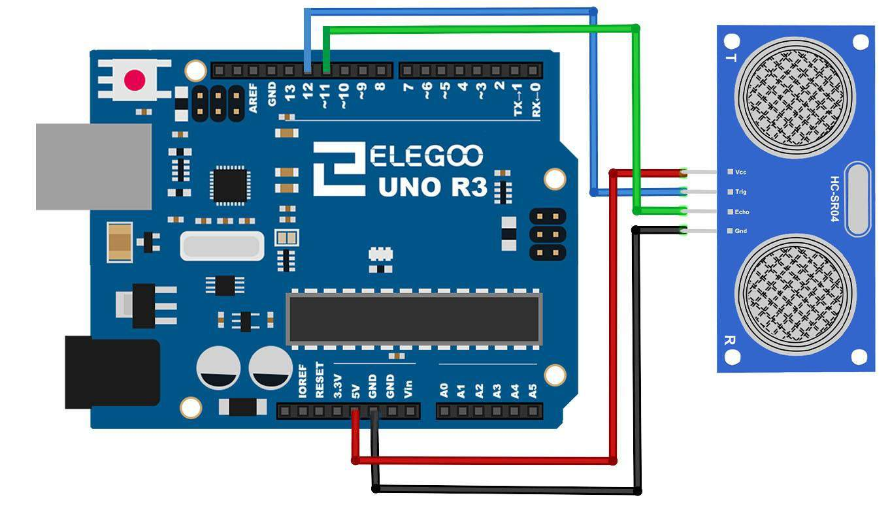
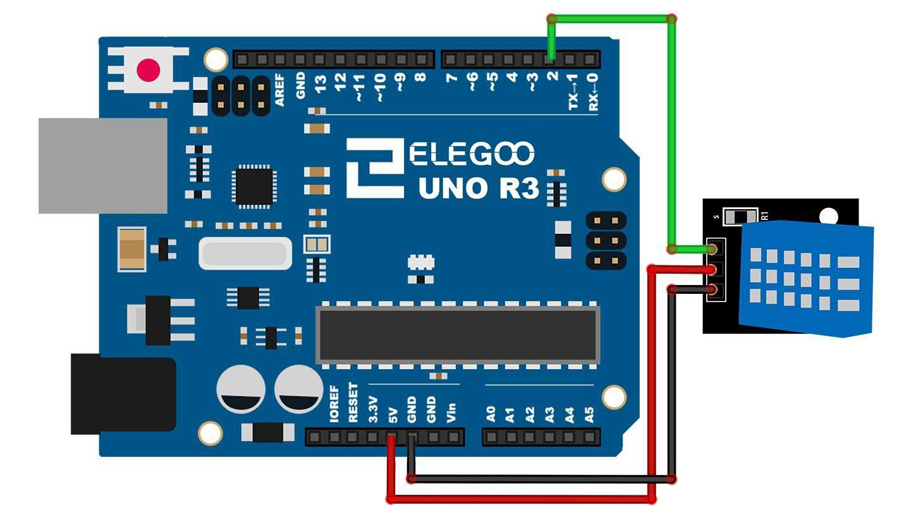
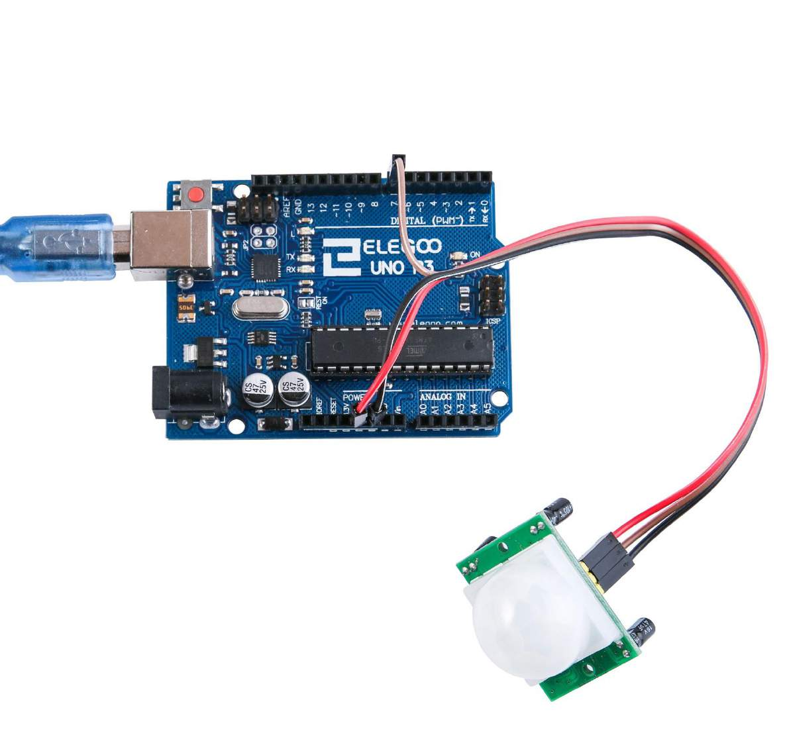

# Module 5 — Surveillance Kit

## Mission brief

Eyes and ears gave you raw signals — a voltage that means light, a
knob that means position. Real field gear doesn't make you do that
work yourself. It comes in little modules with a chip inside that
hands you an answer: *someone is moving*, *it's 22 degrees*, *the
object is 34 centimetres away*. This module is the kit's sensor shelf:
distance, temperature, motion, water, and sound. By the end, you'll
have the parts of a working alarm, and you'll know why some sensors
speak digital, some speak analog, and some speak a protocol of their
own.

## What you'll learn

- The three kinds of sensor output: digital (HIGH/LOW), analog (a
  voltage), and protocol (timed pulses or a bus, decoded by a library)
- Time-of-flight: measuring distance by timing an echo
- Why libraries exist, and what to do when one doesn't compile
- How to combine sensors into one decision: when to raise the alarm

## What you need

Elegoo UNO R3, breadboard, HC-SR04 ultrasonic sensor, DHT11
temperature/humidity module, HC-SR501 PIR motion sensor, water level
sensor module, sound sensor module, buzzer (passive, from Module 4),
jumper wires including female-to-male for the modules.

## Part 1 — The concept: three ways a sensor talks

**Digital sensors** are the simplest: one pin, HIGH or LOW. The PIR
motion sensor is one — it goes HIGH when it sees movement, LOW when
it doesn't. Your code is just `digitalRead`, exactly like a button
in Module 3, except the "button" is pressed by a warm body walking
past.

**Analog sensors** give a voltage, like the photocell and
potentiometer in Module 4. The water level and sound modules both
have an analog output (AO): the more water or the louder the sound,
the higher the voltage, and `analogRead` turns it into a number
0–1023. Some modules also give a digital output (DO) that flips HIGH
past a threshold you set with a little screw on the board — handy
when you only care about "loud enough" rather than "how loud".

**Protocol sensors** send a pattern, not a level. The HC-SR04
ultrasonic sensor needs you to ping it and time the echo. The DHT11
sends temperature and humidity as a timed train of pulses on one
wire. Nobody decodes those by hand if they can help it — that's what
libraries are for. A library is someone else's debugged code for
talking to one specific chip, and using one is not cheating; it's
the normal way this work gets done.

## Part 2 — Build: distance with the ultrasonic sensor

The HC-SR04 has two "eyes": a transmitter and a receiver. You send a
10-microsecond pulse on the Trig pin; the module fires an 8-cycle
burst of 40kHz ultrasound, inaudible to you, and raises the Echo pin
until the sound bounces back. Measure how long Echo stays HIGH and
you've measured the round trip. Sound travels about 343 metres per
second, so distance in centimetres is roughly
(duration in microseconds ÷ 58). Divide by two for the round trip —
the 58 already does that for you.

Wire it as Elegoo draws it: Vcc → 5V, Gnd → GND, Trig → pin 12,
Echo → pin 11.

*The HC-SR04: Vcc, Trig, Echo, Gnd, in that order on the module.
Diagram: Elegoo tutorial, Lesson 10.*

The code is in
[this module's folder](module-05-surveillance-kit/ultrasonic/ultrasonic.ino).
It uses `pulseIn()` to time the echo and prints the distance to the
Serial Monitor. Hold your hand in front of it and move it closer and
further away — the numbers track you. Point it at a soft curtain and
watch it go unreliable: sound needs something to bounce off, and soft
surfaces absorb it. That's a property of the physics, not a bug in
your wiring.

## Part 3 — Build: temperature and humidity with the DHT11

The DHT11 module has three pins: + to 5V, − to GND, and S (the data
pin) to pin 2. It measures temperature (0–50°C, ±2°C) and humidity
(20–90%, ±5%) — coarse, but honest about it, and plenty for a room
monitor. It only gives a new reading about once a second, so don't
poll it in a tight loop and wonder why nothing changes.

You need a library for this one: Elegoo's lesson uses SimpleDHT.
Install it from the Library Manager (Sketch → Include Library →
Manage Libraries, search "SimpleDHT"), then the code in
[this module's folder](module-05-surveillance-kit/dht11/dht11.ino)
reads both values and prints them.

*The DHT11 module: + to 5V, − to GND, S to pin 2. Diagram: Elegoo
tutorial, Lesson 12.*

If the sketch fails to compile with a "no such file" error, it's
almost always the library: wrong library installed, or the IDE not
restarted after installing. Check the `#include` line against the
library name, and check the Library Manager again before you suspect
your wiring.

## Part 4 — Build: motion with the PIR sensor

The HC-SR501 PIR sensor sees infrared — body heat, in practice. Its
output pin is digital: LOW when nothing moves, HIGH (3.3V) when
something warm moves in its view. Wire its power to 5V and GND, and
its output to pin 7, as Elegoo's lesson uses.

*The PIR sensor: the white dome is the lens that focuses infrared
onto the detector. Photo: Elegoo tutorial, Lesson 17.*

The code is in
[this module's folder](module-05-surveillance-kit/pir-alarm/pir-alarm.ino):
read pin 7, light the onboard LED on pin 13 when motion is detected.
Two honest quirks: the sensor needs up to a minute after power-on to
settle, during which it may trigger falsely, and it detects
*movement*, not presence — sit perfectly still in front of it and it
will eventually decide the room is empty. Both of those are the
sensor working as designed, and both matter when you build the alarm
in Part 7.

## Part 5 — Build: water level and sound, the analog pair

The water level module is a set of exposed traces that act as a
variable resistor: the more of them are underwater, the lower the
resistance, the higher the analog reading. Wire it to 5V and GND, and
its analog output to A0. The code is in
[this module's folder](module-05-surveillance-kit/water-level/water-level.ino).
Dip it in a glass of water, a little at a
time, and watch the reading climb. Never power it in water you drink
from, and dry it off afterwards — exposed traces corrode if left
wet.

The sound module has both outputs: AO to A0 for a loudness number,
and DO to pin 3 for a threshold trigger (the screw on the board sets
the threshold; turn it until the module's own LED just stops
flickering in a quiet room). The code in
[this module's folder](module-05-surveillance-kit/sound-level/sound-level.ino)
prints the analog value; clap, and watch it spike.

These two are the Module 4 voltage-divider idea again, with the
sensor built into a module. If you understand why the photocell
circuit worked, you already understand these.

## Part 6 — Stretch goal: the accelerometer

The GY-521 module (MPU-6050 chip) measures acceleration and rotation
on three axes, and it talks I²C — a two-wire bus, SDA to A4 and SCL
to A5 on the UNO. It needs its library, and its readings are raw
numbers that need converting to g's and degrees before they mean
anything. It's the most powerful sensor in the kit and the least
plug-and-play, which is why it's a stretch goal here rather than a
full build: if you get the other five working, try it next, and
expect to spend an evening calibrating it. Module 7's RFID and RTC
use the same I²C bus, so this is a preview of that world.

## Part 7 — Build: the surveillance post

Now combine three of them into one decision. The code is in
[this module's folder](module-05-surveillance-kit/surveillance-post/surveillance-post.ino):

- PIR on pin 7 watches for movement.
- HC-SR04 (Trig 12, Echo 11) measures how far away the movement is.
- If motion is detected *and* the object is closer than 50 cm, the
  buzzer on pin 8 sounds — the Module 4 `tone()` call, one note, for
  one second.

The combination is the lesson: one sensor gives false alarms, two
sensors agreeing give a decision you can act on. That's the whole
philosophy of real alarm systems, in miniature.

## Break it on purpose

1. **Swap Trig and Echo.** The sensor goes silent — it never hears
   an echo because you never told it to ping. A sensor that reads
   nothing at all is usually a wiring swap, not a dead sensor.
2. **Read the DHT11 twice a second.** It returns stale or failed
   readings. The sensor's own pace is part of its specification, and
   ignoring it looks exactly like a broken sensor.
3. **Set the sound threshold too low.** The DO pin stays HIGH
   forever in a normal room. Thresholds are set for the room you're
   in, not in the abstract — recalibrate when you move the sensor.

## If it doesn't work

- Ultrasonic reads 0 or a huge fixed number? Check Trig/Echo aren't
  swapped, and that the sensor faces a hard, flat surface at least a
  few centimetres away.
- DHT11 reads nothing? Library first, then wiring — and remember it
  only updates about once a second.
- PIR triggers constantly? Give it a minute to settle after power-on,
  and check it isn't facing a window with sun moving across it or a
  radiator cycling on and off.
- Water level reads the same wet or dry? The analog wire is on the
  wrong pin, or the module isn't actually powered — the traces need
  5V across them to change anything.

## Debrief

Your gear now has a proper sensor shelf: distance, temperature,
humidity, motion, water, sound — and a decision rule that combines
them. The handler's report: *the recruit can watch a room now*. The
next step is to make the gear report what it sees, and to lock it
down: displays, time, and keys.

Next mission: Module 6, Exfiltration — getting the data out.

*Diagrams in this module are from the Elegoo Complete Starter Kit
tutorial (Lessons 10, 12, and 17).*
