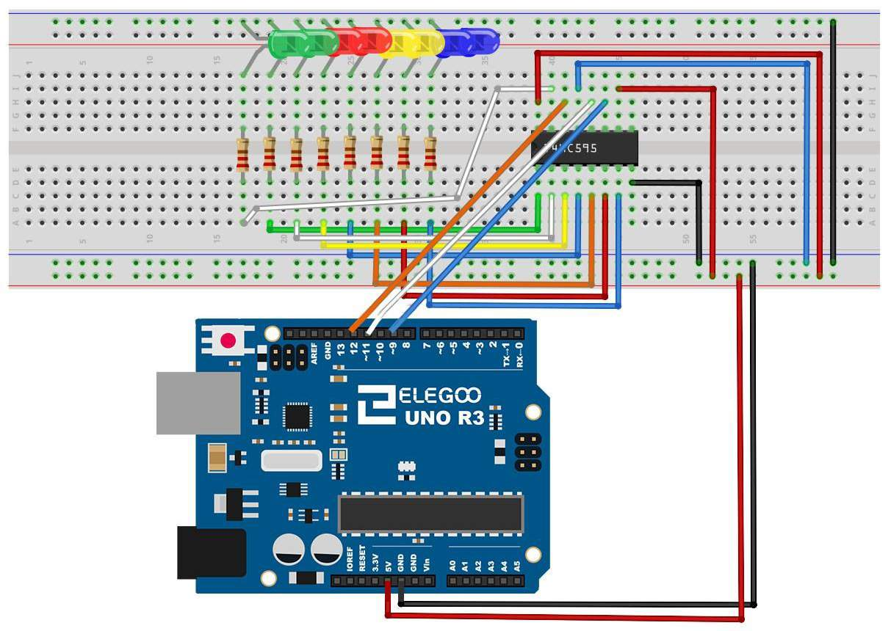
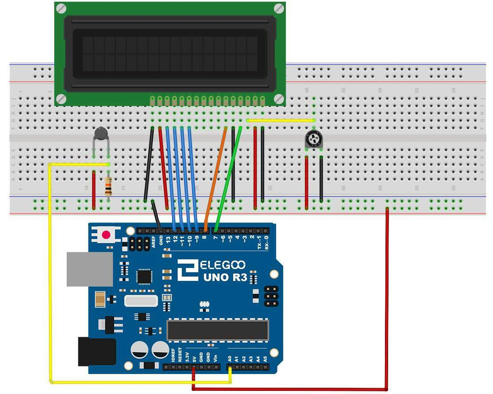
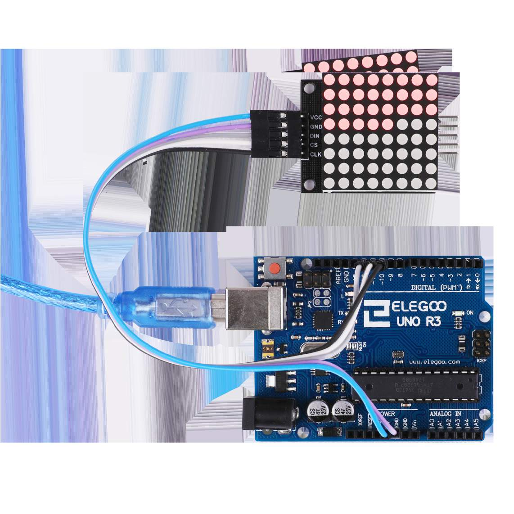

# Module 6 — Exfiltration

## Mission brief

Your gear can sense a room now. That's no use if it can't tell
anyone. Serial Monitor printouts are fine at your desk, but field
gear needs to report on its own face: a number, a word, a symbol.
This module is about displays — and about the problem that makes
displays interesting. The UNO has 14 digital pins, and a display can
eat them all. The answer is to stop giving every light its own pin,
and start sending data serially: one wire, many outputs, in a queue.

## What you'll learn

- Serial-in, parallel-out: how a shift register turns 3 pins into 8
  outputs (and 8 into as many as you chain)
- How a 7-segment display is just 8 LEDs in a familiar shape
- How an LCD takes text, and why its contrast pin matters
- How a dot-matrix module hides 64 LEDs behind 3 pins and a driver
  chip

## What you need

Elegoo UNO R3, breadboard, 74HC595 shift register, eight LEDs with
eight 220Ω resistors, one-digit 7-segment display, four-digit
7-segment display (stretch goal), MAX7219 dot-matrix module, 1602
LCD, 10kΩ potentiometer for LCD contrast, thermistor (for the
thermometer build), jumper wires.

## Part 1 — The concept: running out of pins

Eight LEDs, wired the Module 1 way, need eight pins plus ground.
That's more than half the UNO's digital pins gone on one row of
lights. A shift register fixes it. The 74HC595 takes data in one bit
at a time on a data pin, clocked in by a clock pin, and only shows
the result on its outputs when you pulse a latch pin. Send eight
bits, pulse the latch, and eight outputs update at once. Chain a
second chip onto the first and you get sixteen outputs from the same
three pins — the chips just pass the bits along.

The same idea, taken further, is inside the dot-matrix module and
the LCD: a driver chip that takes a serial stream and handles the
dozens of individual connections itself. You talk to the chip, the
chip talks to the lights.

## Part 2 — Build: eight LEDs from three pins

Wire the 74HC595 as Elegoo draws it: the chip straddles the
breadboard's centre channel, its eight outputs each go through a
220Ω resistor to an LED and then to GND, and the UNO connects on
three pins — latch to pin 11, clock to pin 9, data to pin 12 — plus
5V and GND to the chip itself.

*The shift register: eight LEDs, three UNO pins, one chip doing the
fan-out. Diagram: Elegoo tutorial, Lesson 24.*

The code is in
[this module's folder](module-06-exfiltration/shift-leds/shift-leds.ino).
It keeps the LED pattern in one byte — one bit per LED — and sends
it with `shiftOut(dataPin, clockPin, LSBFIRST, leds)`, bracketed by
latch LOW and latch HIGH. The sketch lights the LEDs one at a time
down the row, then clears them: a running light, built from a single
byte. Change the byte and you change the picture — `0b10101010`
lights every other LED, and that's the whole trick in one line.

## Part 3 — Build: a digit from segments

A 7-segment display is seven LEDs arranged as a figure eight, plus
a decimal point — eight segments, which is exactly one shift
register's worth. That's why Elegoo's Lesson 27 drives one through
the 74HC595: same three pins, same `shiftOut`, different picture.
Each digit 0–9 is a byte with the right segments set: 0 lights
everything except the middle bar, 1 lights only the two right-hand
bars, and so on.

The code pattern is the same as Part 2 with a lookup table: an array
of ten bytes, one per digit, and a counter that steps through them.
Build it as a stretch goal on the same wiring as Part 2, swapping
the eight separate LEDs for the display — the common-cathode version
in the kit has its shared pin to GND, and the segment order in
Elegoo's lesson table is the one to copy if your digits come out
scrambled.

The four-digit display in Lesson 28 adds one more idea:
multiplexing. It has the same eight segment pins, shared by all four
digits, plus four digit-select pins. Light one digit at a time, very
fast, and your eye blends them into four digits — the same
persistence trick as PWM in Module 4, applied to whole digits. If
your four-digit display flickers, the code is switching digits too
slowly; if it shows the same digit four times, a digit-select pin
isn't wired.

## Part 4 — Build: words on the LCD

The 1602 LCD shows 16 characters on each of two lines, and Elegoo's
lesson wires it in 4-bit mode: RS to pin 7, EN to pin 8, D4 to pin 9,
D5 to pin 10, D6 to pin 11, D7 to pin 12, plus 5V and GND, and a
10kΩ potentiometer on the contrast pin (VO). That last one is the
one everyone forgets: with the contrast wrong, the display looks
dead even when it's working perfectly. Turn the pot slowly until the
characters appear.

*The LCD: six data pins, power, and a contrast pot. The thermistor
on the left of this diagram belongs to the thermometer build in
Part 5 — ignore it for the hello-world build. Diagram: Elegoo
tutorial, Lesson 22.*

The code is in
[this module's folder](module-06-exfiltration/lcd-hello/lcd-hello.ino)
and uses the LiquidCrystal library (built into the IDE, no install
needed): `LiquidCrystal lcd(7, 8, 9, 10, 11, 12)`, then
`lcd.print("Hello, crew")` and `lcd.setCursor(0, 1)` for the second
line. Two lines, sixteen characters each, and suddenly your sensor
readings have somewhere to go that isn't a laptop.

## Part 5 — Build: a thermometer that reports itself

Now put Module 5 and this module together. A thermistor is a
resistor that changes with temperature — the same voltage-divider
idea as the photocell in Module 4. Read it on A0, convert the
reading to a temperature (Elegoo's Lesson 23 does this with the
Steinhart-Hart equation, and its sketch is the one to copy for the
conversion), and print it on the LCD instead of the Serial Monitor.

The code is in
[this module's folder](module-06-exfiltration/lcd-thermometer/lcd-thermometer.ino).
It reads the thermistor, prints the temperature on the LCD's first
line, and — because a field device should say what it is — a status
word on the second. Hold the thermistor between your fingers and
watch the number climb. You've just built the first piece of gear in
this course that could sit on a shelf and be useful without a
computer attached.

## Part 6 — Build: a symbol on the dot matrix

The MAX7219 dot-matrix module is 64 LEDs in an 8×8 grid, driven by
one chip, over three pins: DIN to pin 12, CS to pin 11, CLK to pin 10.
You need a library for it — Elegoo's lesson uses the LedControl
library — and then you describe a picture as eight bytes, one per
row, where each bit is one LED. The code is in
[this module's folder](module-06-exfiltration/matrix-smiley/matrix-smiley.ino)
and draws a smiley face, because a smiley is the traditional first
picture and because it proves every row works.

*The dot-matrix module: VCC, GND, DIN, CS, CLK — five wires, 64
LEDs. Photo: Elegoo tutorial, Lesson 15.*

Sixty-four LEDs, three pins. That's the whole module in one
sentence: the shift-register idea, with a driver chip that also
handles the multiplexing for you.

## Break it on purpose

1. **Latch at the wrong time.** Leave the latch HIGH while you
   shift data in, and the LEDs flicker through every intermediate
   pattern instead of changing cleanly. Latch LOW, shift, latch
   HIGH — the order is the interface.
2. **LCD with the contrast at either extreme.** All blocks, or
   nothing at all. Both look like a dead display, and both are fixed
   by one pot turn.
3. **Shift the bits the wrong way round.** Use MSBFIRST instead of
   LSBFIRST and your running light runs backwards, or your digit
   comes out mirrored. The data is the same; the order you feed it
   in is what changed.

## If it doesn't work

- Shift register LEDs all dark? Chip power first — the 74HC595
  needs 5V and GND of its own, not just the three signal pins.
- One LED in the row never lights? Its resistor or LED leg isn't
  seated, or that output pin on the chip is bent under the board.
- LCD shows blocks on the first line only? It's powered but not
  initialised — check the RS/EN wiring, and that `lcd.begin(16, 2)`
  ran.
- Dot matrix dark? Library first, then the three pins — and check
  the module's VCC is 5V, not 3.3V.

## Debrief

Your gear can now report: numbers on segments, words on an LCD,
symbols on a matrix — all without running out of pins. The handler's
report: *the recruit's gear can talk back*. The last pieces are
time and access: a clock that keeps running when the power doesn't,
and a key that decides who gets in.

Next mission: Module 7, Time Locks and Keys — the RTC, RFID, and
the Serial Monitor as a debug tool.

*Diagrams in this module are from the Elegoo Complete Starter Kit
tutorial (Lessons 15, 22, and 24).*
