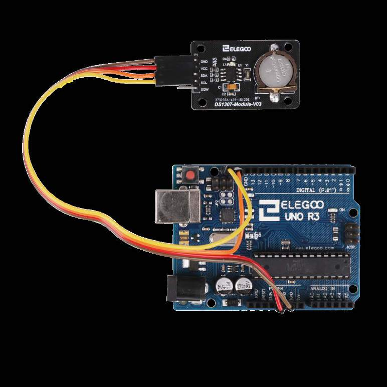

# Module 7 — Time Locks and Keys

## Mission brief

A sensor that only works while the power is on is a toy. Real gear
remembers: what time it is, who opened the door, whether it was
allowed. This module gives your kit a clock that survives a power
cut and a key that isn't a key at all — a card that answers a radio
challenge. Together they make the first genuinely lock-like thing in
this course: something that decides, on its own, whether to say yes.

## What you'll learn

- I²C: a two-wire bus that lets many chips share two pins
- SPI: a faster four-wire bus, and why the RFID reader uses it
- Battery-backed time: why a clock chip keeps counting when the
  UNO doesn't
- The Serial Monitor as a debugging tool, not just a printout
- Access logic: combining an identity check with a time check

## What you need

Elegoo UNO R3, breadboard, DS1307 (or DS3231) real-time clock
module with its coin cell, RC522 RFID reader with a card and a
key fob, 1602 LCD (from Module 6), buzzer, one red and one green
LED with 220Ω resistors, jumper wires including female-to-male.

## Part 1 — The concept: two buses, two kinds of memory

The UNO's `millis()` counts milliseconds since power-on. Unplug the
board and it forgets everything, including what time it was. A
real-time clock (RTC) module fixes that: a dedicated chip with its
own coin-cell battery that keeps counting seconds, minutes, hours,
and days while the UNO is off. When the UNO powers up again, it just
asks the chip what time it is.

The RTC talks I²C — Inter-Integrated Circuit — a bus with two
wires, SDA (data) and SCL (clock), on pins A4 and A5. Many chips can
share those same two wires, each answering to its own address. The
GY-521 accelerometer from Module 5's stretch goal is also an I²C
device, which is why this bus keeps coming up: learn it once, reuse
it everywhere.

The RFID reader talks SPI — Serial Peripheral Interface — which is
faster and uses four wires: MOSI, MISO, SCK, plus a chip-select (SS)
and a reset line. SPI is the bus for things that move more data, or
move it faster, than I²C comfortably handles. The two buses aren't
rivals; they're different tools, and a real project often uses both
at once, as this module's final build does.

## Part 2 — Build: a clock that survives unplugging

Wire the RTC module as Elegoo draws it: VCC to 5V, GND to GND, SDA
to A4, SCL to A5. Ignore the 32K and SQW pins — you won't need them.
Make sure the coin cell is in place; without it, the module is just
a chip that forgets like everything else.

*The RTC module: four wires, plus a coin cell that keeps it counting
when the UNO is off. Photo: Elegoo tutorial, Lesson 19.*

You need a library: RTClib, from the Library Manager. The code is
in
[this module's folder](module-07-time-locks-and-keys/rtc-clock/rtc-clock.ino).
It sets the clock once, from the time the sketch was compiled
(`rtc.adjust(DateTime(F(__DATE__), F(__TIME__)))`), then reads it
back every second and prints it. Upload it, open the Serial
Monitor, unplug the UNO for a minute, plug it back in, and check:
the time should have kept going while you weren't looking. If it
reset to the compile time, the coin cell is missing, dead, or in
backwards — that one check tells you everything about whether the
module is working.

One caution: that `adjust` line sets the clock every time the sketch
starts if you leave it in. Set the time once, then comment it out
and re-upload, or your clock will cheerfully reset itself to the
compile time on every power-up and you'll never notice until the
final build misbehaves.

## Part 3 — Build: a card that answers

The RC522 reader works at 13.56 MHz and talks to MIFARE cards and
key fobs — the kind in the kit, one flat card and one fob. Each has
a UID, a serial number the reader can see without knowing any
secret. Wire it as Elegoo draws it: SDA (SS) to pin 10, RST to pin 9,
MOSI to pin 11, MISO to pin 12, SCK to pin 13, VCC to **3.3V** (not
5V — this module is a 3.3V part, and 5V can damage it), GND to GND.

*The RC522: SPI pins plus reset, and 3.3V power — the one wiring
detail in this module that actually matters for the hardware's
health. Diagram: Elegoo tutorial, Lesson 21.*

You need the MFRC522 library. The code is in
[this module's folder](module-07-time-locks-and-keys/rfid-reader/rfid-reader.ino).
Hold a card near the reader and the Serial Monitor prints its UID
in hex. That's the whole read: no password, no pairing, just a
number. Hold the fob up and you get a different number. Write those
numbers down — they're the keys for the next build, and they're
yours, not anyone else's.

A note on what this is and isn't: a UID is an identifier, not a
secret. Anyone with a reader can read your card's UID, and a UID
alone is not real security — real access systems use cryptographic
challenge-response, which this module doesn't. For a desk project
and a story about a crew's door, a UID check is exactly the right
level. Don't use it to guard anything that matters.

## Part 4 — The Serial Monitor as a debug tool

You've used the Serial Monitor in every module so far, mostly to
watch numbers go by. This module is where it becomes a tool rather
than a display. Elegoo's Lesson 25 is built around it, and the
habits are worth naming:

- Print what you *expected* next to what you *got*. "Expected
  card, got nothing" is a diagnosis; a blank screen is a mystery.
- Print at decision points, not in every loop iteration. A
  thousand lines a second hides the one line that matters.
- Use it to set things: read a line from the Serial Monitor with
  `Serial.readStringUntil('\n')` and you can type a new threshold,
  a new UID, or a new time window without re-uploading.
- When a sketch misbehaves, add prints and re-upload. It's slower
  than a debugger and more honest than guessing, and it's how most
  Arduino work actually gets debugged.

## Part 5 — Build: the time lock

Now combine the two. The code is in
[this module's folder](module-07-time-locks-and-keys/time-lock/time-lock.ino):

- The RC522 reads a card and gets its UID.
- The RTC says what time it is.
- Access is granted only if *both* checks pass: the UID matches
  one you've stored, and the hour is between 9 and 17.
- Granted: green LED, one happy chirp on the buzzer, and the
  attempt logged to the Serial Monitor with the time.
- Denied: red LED, a low buzz, and the denial logged too — with
  the UID, so you can see who tried.

Before you run it, replace the placeholder UID in the sketch with
the UID your own card printed in Part 3. The first time it denies
your card, check the UID first, then the clock — in that order, and
you'll find the bug in seconds rather than minutes.

This is the module's thesis in one build: a decision made from two
independent facts, logged with a timestamp. Sensors told you what
was happening; displays told someone else; now the board decides,
and remembers deciding.

## Break it on purpose

1. **Power the RC522 from 5V.** Don't, actually — this one is a
   warning, not an experiment. The module is a 3.3V part, and the
   wrong rail is the fastest way to kill it in this course.
2. **Leave the RTC adjust line in.** Your clock resets to compile
   time on every boot, and the time lock denies you at 9am because
   it thinks it's the afternoon of the day you compiled. A perfect
   example of a bug that looks like a hardware fault.
3. **Swap MOSI and MISO.** The reader goes silent — SPI is
   directional, and the two data lines are not interchangeable.
   Silence from an SPI device is usually a wiring swap, as with
   the ultrasonic sensor in Module 5.

## If it doesn't work

- RTC reads the same time forever? Coin cell, then I²C wiring —
  SDA to A4, SCL to A5, and both need to be right, not just one.
- RFID reader silent? 3.3V first, then the SPI pins in order: SS 10,
  RST 9, MOSI 11, MISO 12, SCK 13.
- Time lock denies a good card at a good hour? Print the UID and
  the hour to the Serial Monitor and compare them to the sketch —
  the bug is in one of those two comparisons, and the printout
  tells you which.
- LCD from Module 6 blank in this build? It's the contrast pot
  again. It is always the contrast pot.

## Debrief

Your gear now knows what time it is, who just walked up, and
whether to say yes — and it writes it all down. The handler's
report: *the recruit's gear has a memory and a door policy*. One
module left before the finale: things that move, and things that
switch real power.

Next mission: Module 8, Physical Access — motors and relays.

*Diagrams in this module are from the Elegoo Complete Starter Kit
tutorial (Lessons 19 and 21).*
