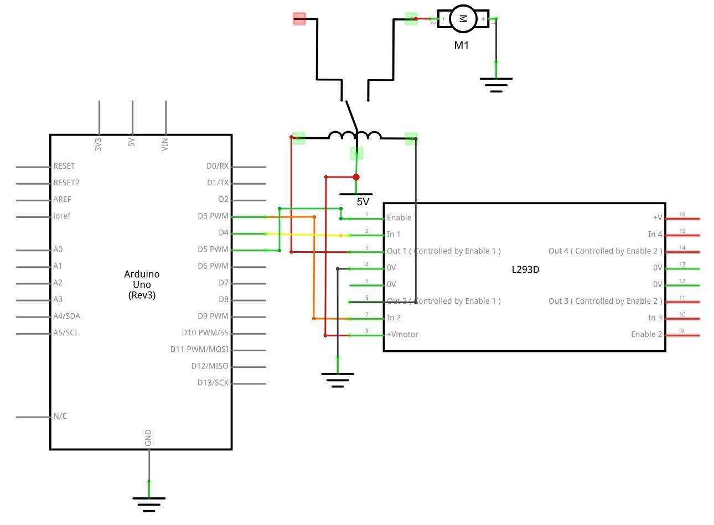
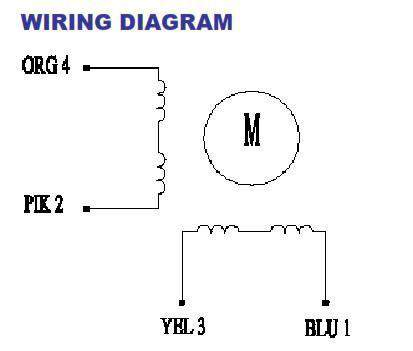

# Module 8 — Physical Access

## Mission brief

Everything so far has been signals: lights, sounds, numbers on a
screen. Nothing has *moved*. This module is where the gear starts
pushing back on the world: a servo that turns a lock, a motor that
spins, a relay that switches a load far heavier than the UNO could
ever drive itself. It's also where the course gets serious about
safety, because motors don't care about your code — they care about
current, and current is where boards get hurt.

## What you'll learn

- Why you never power a motor from an Arduino pin, and what a
  driver chip is for
- Servos: position control by pulse width, and why a servo knows
  where it is
- DC motors: direction by H-bridge, speed by PWM
- Stepper motors: position by counting steps, no feedback needed
- Relays: switching a separate circuit with a small signal, and
  why the two circuits must stay separate

## What you need

Elegoo UNO R3, breadboard, SG90 servo, DC motor with fan blade,
L293D motor driver chip, 28BYJ-48 stepper motor with ULN2003
driver board, relay, separate battery pack for the motors (the
kit's 9V battery clip or a 4×AA pack), jumper wires.

## Part 1 — The concept: the pin is not a power supply

An Arduino pin can source about 20mA comfortably, 40mA at most.
A small DC motor at stall can want ten times that, and when it
starts or stops it throws voltage spikes back down the wire. Wire
a motor straight to a pin and you will, sooner or later, damage the
pin, reset the board, or both. Elegoo's Lesson 29 says this plainly,
and it's the rule this whole module hangs on: the UNO *signals*,
something else *powers*.

That something else is a driver: a chip or board that takes a small
control signal from the UNO and switches a separate, beefier power
supply to the motor. The servo has its driver built in. The DC motor
gets the L293D. The stepper gets the ULN2003 board. The relay is the
same idea taken to its limit: the UNO's signal switches a
completely separate circuit, which can be a motor, a lamp, or
anything else — electrically isolated from the board itself.

## Part 2 — Build: a servo that knows where it is

A servo is a geared motor with a position sensor and a control
circuit built in. You don't tell it "spin"; you tell it "go to 90
degrees" and it gets itself there, and holds there. It takes a
pulse every 20 milliseconds, and the pulse's width is the position:
about 1ms for 0°, 1.5ms for 90°, 2ms for 180°. That's PWM again —
the same idea as dimming an LED in Module 4, now steering a shaft.

Wire it as Elegoo draws it: brown to GND, red to 5V, orange signal
to pin 9.

*The servo: brown ground, red power, orange signal on pin 9.
Diagram: Elegoo tutorial, Lesson 9.*

The code is in
[this module's folder](module-08-physical-access/servo-sweep/servo-sweep.ino)
and uses the Servo library (built into the IDE): `servo.attach(9)`,
then `servo.write(angle)` sweeps it from 0 to 180 and back. If your
servo jitters at the ends of travel, it's hitting its mechanical
limits — back off to 10–170 degrees and the jitter goes away. A
servo that buzzes loudly at rest is usually trying to hold a
position it can't quite reach; same fix.

## Part 3 — Build: a DC motor that spins both ways

A DC motor spins when current flows through it, and reverses when
the current reverses. An H-bridge — four switches arranged like the
letter H, with the motor as the crossbar — does exactly that
reversal, and the L293D chip contains two of them. Elegoo's Lesson
29 schematic drives one motor through it: an Enable pin on a PWM
pin for speed, and two input pins for direction.

*The L293D: one half of the chip, one motor, with an enable pin for
speed and two inputs for direction. Schematic: Elegoo tutorial,
Lesson 29.*

The code is in
[this module's folder](module-08-physical-access/dc-motor/dc-motor.ino).
It uses Enable on pin 3 (PWM, for speed), In1 on pin 4, In2 on pin 5:
In1 HIGH and In2 LOW spins one way, swapped spins the other, both
LOW stops, and `analogWrite` on the Enable pin sets the speed.
Power the motor side from the separate battery pack, not from the
UNO's 5V pin — a motor and a microcontroller sharing one small
supply is how you get brownouts that look like software bugs. Tie
the grounds together, though: without a shared ground, the control
signal has no reference and nothing works at all.

## Part 4 — Build: a stepper that counts its way round

A stepper motor doesn't spin freely; it steps, in small fixed
increments, and it remembers how many steps it has taken. The
28BYJ-48 in the kit steps 2048 times per full revolution (through
its internal gearing), so you can say "turn 90 degrees" as "take
512 steps" and trust it, with no position sensor at all. That's
open-loop control, and it's why steppers are everywhere in
printers and camera sliders.

Wire the ULN2003 driver board's four inputs to pins 8, 9, 10, and
11, as Elegoo's Lesson 31 uses, and the board's power to the
separate supply, with grounds tied together as in Part 3.

*The stepper's coils: the driver board energises them in sequence,
and the shaft follows. Diagram: Elegoo tutorial, Lesson 31.*

The code is in
[this module's folder](module-08-physical-access/stepper-turn/stepper-turn.ino)
and uses the Stepper library: `Stepper stepper(2048, 8, 10, 9, 11)`
(note the pin order — the library expects them in a specific
sequence, and getting it wrong makes the motor vibrate in place
instead of turning), then `stepper.step(512)` for a quarter turn.
If it buzzes without moving, the pin order is the first thing to
check; if it turns the wrong way, swap the sign of the step count.

## Part 5 — Build: a relay that switches a separate circuit

A relay is an electrically operated switch: a small current through
its coil pulls a contact closed, connecting a completely separate
circuit. That separation is the point. The UNO side might switch a
few milliamps at 5V; the other side can switch a motor, a lamp, or
a mains device — though mains is out of scope for this course, and
you should not wire mains through a breadboard relay as a learning
exercise.

The code is in
[this module's folder](module-08-physical-access/relay-switch/relay-switch.ino).
It drives the relay's control pin (pin 7 on a relay module, or the
transistor-driven coil in Elegoo's Lesson 30 schematic) HIGH for
two seconds, LOW for two seconds, and you hear the click each time
it changes state. Click, pause, click, pause: that's a switch
operated by software, and it's the last piece of the finale's
puzzle — a board that can decide, and then *do* something about
it, in the physical world.

Two safety habits, non-negotiable: keep the relay's switched
circuit physically separate from the UNO's circuit, and never
switch a load bigger than the relay is rated for. The rating is
printed on the relay itself; read it before you wire anything to
the contacts.

## Break it on purpose

1. **Drive a servo past its limits.** Command 0 and 180 and listen
   for the buzz at the ends. That's a servo straining against its
   own gears — back off the range and it goes quiet.
2. **Run a DC motor from the UNO's 5V pin.** It may work, briefly,
   and then the board resets when the motor starts. That's a
   brownout, and it's the lesson Part 1 warned about, learned the
   memorable way.
3. **Get the stepper pin order wrong.** The motor vibrates and
   goes nowhere. One swap, and it turns smoothly — the difference
   between a sequence and a scramble.

## If it doesn't work

- Servo doesn't move? Signal wire on the wrong pin, or the Servo
  library not attached — `servo.attach(9)` has to run before any
  `servo.write`.
- DC motor spins one way only? One input pin isn't connected — an
  H-bridge needs both inputs to reverse.
- Stepper vibrates in place? Pin order, as above — or the driver
  board isn't powered from the separate supply.
- Relay clicks but the load doesn't switch? You're switching the
  normally-closed contact instead of the normally-open one, or
  vice versa — check which terminal is NO and which is NC.

## Debrief

Your gear can now move: a servo to a position, a motor in either
direction at any speed, a stepper by counted steps, and a relay to
switch anything else. The handler's report: *the recruit's gear has
hands now*. Every skill in this course is on the table. Time to use
them all at once.

Next mission: The Finale — The Job.

*Diagrams in this module are from the Elegoo Complete Starter Kit
tutorial (Lessons 9, 29, and 31).*
